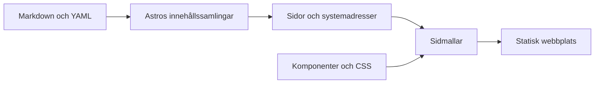

# VizWay Webbplats

VizWay utvecklar och förvaltar egna intelligenta digitala system. Webbplatsen presenterar verksamheten och visar färdiga system, pågående utveckling och framtida idéer.

## Installera och kör lokalt

Använd Node.js 22.12.0 eller senare och npm. Kör följande kommandon från projektroten.

```sh
npm ci


npm run dev
```

Öppna den lokala adress som Astro visar i terminalen. Avsluta servern med `Ctrl+C`.

Bygg webbplatsen efter en innehållsändring. Förhandsgranska bygget lokalt vid behov.

```sh
npm run build


npm run preview
```

Astro sparar det statiska bygget i `dist/`.

## Redigera innehåll

| Innehåll | Redigera |
| --- | --- |
| Startsidans rubrik och vers | `src/content/pages/start.md` |
| Systemöversiktens introduktion | `src/content/pages/system.md` |
| Om VizWay | `src/content/pages/om.md` |
| Kontakt | `src/content/pages/kontakt.md` |
| Företagsnamn och slogan | `src/content/site/identitet.yaml` |
| En systemsida | En Markdown-fil i `src/content/systems/` |

Redigera rubriken i YAML-fältet `title` och sidans beskrivning i `description`. Redigera brödtexten under det andra `---`. Börja eventuella avsnittsrubriker med `##` eftersom sidmallen visar sidans huvudrubrik.

Lägg till fältet `email` i YAML-blocket i `kontakt.md` när VizWay har fastställt adressen. Då visar kontaktsidan en e-postlänk. Om fältet saknas visas en statusrad för kontaktuppgifterna.

## Redigera startsidans hero

| Ändring | Redigera |
| --- | --- |
| Bakgrund | Lägg bildfilen i `public/images/hero/`. Ange sökväg, bildmått och vid behov beskärning i `src/components/hero/HeroBackground.astro`. |
| Logotyp | Ändra namn och slogan i `src/content/site/identitet.yaml`. Redigera ordmärkets typografi, linje och stjärna i `src/components/hero/HeroLogo.astro`. |
| Rubrik och vers | Ändra den vita delen i `title` och den turkosa delen i `heroAccent` i `src/content/pages/start.md`. Skriv varje versrad som ett eget stycke med en tom rad mellan styckena. |
| Placering och avstånd | Ändra ordningen, rutnätet och avstånden i `src/components/hero/Hero.astro`. Låt HTML-ordningen följa läsordningen. |
| Färger, typsnitt och textstorlek | Ändra gemensamma färger och det lokala typsnittet i `Hero.astro`. Ändra textstorlek i `HeroLogo.astro`, `HeroTitle.astro`, `HeroText.astro` och `HeroExplore.astro`. |
| Utforska-länken | Ändra länktext, mål och utseende i `src/components/hero/HeroExplore.astro`. |

## Lägg till, ändra eller kategorisera ett system

1. Skapa en Markdown-fil i `src/content/systems/`. Använd gemener, siffror och bindestreck i filnamnet. `mitt-system.md` ger adressen `/system/mitt-system/`.
2. Lägg till YAML-blocket nedan. `title` och `description` visas både på kortet och på systemsidan.
3. Välj kategori och status i tabellerna nedan. Ange ett lägre `order` för att visa systemet tidigare i sin kategori. Vid samma värde sorteras projekten efter svensk titel.
4. Använd rubrikerna `## Syfte och tänkt användning`, `## Nuvarande utveckling` och `## Framtida möjligheter` i brödtexten. Beskriv verifierade funktioner och pågående arbete under nuvarande utveckling. Beskriv planerade funktioner under framtida möjligheter.
5. Ändra en befintlig post i samma fil för att behålla dess adress. Kör `npm run build` och kontrollera kortets kategori, status och länk på `/system/`.

```yaml
---
title: Mitt system
description: En kort beskrivning av systemets tänkta nytta.
status: ide
category: tillampningar
order: 40
---
```

| `category` | Grupp på systemöversikten |
| --- | --- |
| `tillampningar` | System och tillämpningar |
| `teknik` | Teknik och plattformar |

| `status` | Visas som |
| --- | --- |
| `fardig` | Färdigt |
| `utveckling` | Under utveckling |
| `ide` | Framtida idé |

Om `category` eller `order` saknas används `tillampningar` respektive `100`. Den valfria listan `flow` visar projektets delar på kortet. Se formatet i [kvittoapp.md](src/content/systems/kvittoapp.md). Fältet `example: true` lägger till märkningen **Exempel**.

## Projektstruktur

| Katalog eller fil | Ansvar |
| --- | --- |
| `src/content/` | Sidtexter, systemposter och identitet |
| `src/content.config.ts` | Läser in och validerar innehåll och metadata |
| `src/pages/` | Webbplatsens adresser och sidornas sammansättning |
| `src/layouts/` | Gemensam sidram samt mallar för informationssidor och systemsidor |
| `src/components/` | Startsidans hero, systemkort, huvudnavigation och temaväxling |
| `src/lib/` | Innehållshämtning och systemstatus |
| `src/styles/global.css` | Färger, typografi, ljust och mörkt tema samt responsiv layout |
| `_doc/img/` | Designreferenser för lokal dokumentation |



Kontrollera startsidan, navigeringen, eventuella ändrade systemsidor och båda temana när du verifierar en ändring.
