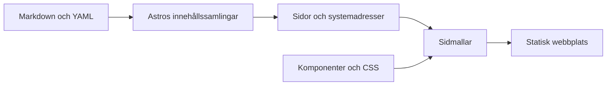

# VizWay Webbplats

VizWay utvecklar och förvaltar egna intelligenta digitala system. Webbplatsen presenterar verksamheten och visar färdiga system, pågående utveckling och framtida idéer.

## Installera och kör lokalt

Använd Node.js 22.12.0 eller senare och npm. Kör följande kommandon från projektroten.

```sh
npm ci


npm run dev
```

Öppna den lokala adress som Astro visar i terminalen. Avsluta servern med `Ctrl+C`.

Bygg webbplatsen efter en innehållsändring. Förhandsgranska bygget lokalt vid behov.

```sh
npm run build


npm run preview
```

Astro sparar det statiska bygget i `dist/`.

## Redigera innehåll

| Innehåll | Redigera |
| --- | --- |
| Startsidans rubrik och vers | `src/content/pages/start.md` |
| Systemöversiktens introduktion | `src/content/pages/system.md` |
| Om VizWay | `src/content/pages/om.md` |
| Kontakttext och e-postadress | `src/content/pages/kontakt.md` |
| Företagsnamn och slogan | `src/content/site/identitet.yaml` |
| En systemsida | En Markdown-fil i `src/content/systems/` |

Redigera rubriken i YAML-fältet `title` och sidans beskrivning i `description`. Redigera brödtexten under det andra `---`. Börja eventuella avsnittsrubriker med `##` eftersom sidmallen visar sidans huvudrubrik.

Ändra kontaktsidans adress i YAML-fältet `email` i `kontakt.md`. Adressen visas som text och används som mål för e-postlänken. Fältet `signature` innehåller den avslutande signaturen. Godkända textunderlag för Om VizWay och Kontakt ligger i `_doc/`.

## Redigera och verifiera språkversionerna

Astros språkstyrning finns i `astro.config.mjs`. Svenska är standardspråk. Engelska använder prefixet `/en/` och samma sökväg efter prefixet, till exempel `/om/` och `/en/om/`. Sidfilerna i `src/pages/` väljer språk. Komponenterna i `src/views/` och `src/layouts/` används av båda versionerna.

| Innehåll | Svenska | Engelska |
| --- | --- | --- |
| Start, System, Om VizWay och Kontakt | `src/content/pages/` | `src/content/en/pages/` |
| Systemens texter | `src/content/systems/` | `src/content/en/systems/` |
| Menytexter, kategorier, statusnamn och andra etiketter | `src/content/ui/sv.yaml` | `src/content/ui/en.yaml` |

Redigera `title`, `description` och brödtexten i rätt språkfil. Båda kontaktsidorna hämtar e-postadressen från svenska `kontakt.md`. Produktnamn och slogan används på båda språken.

`src/lib/i18n.ts` använder Astros språklänkar för att skapa adresserna till samma sida på svenska och engelska. Språkvalet och sidans `hreflang` använder samma adresspar. Sidramen sätter `lang` och den kanoniska adressen med den domän som anges i Astro-konfigurationen.

Kör `npm run build` och öppna båda adresserna från `dist/` över lokal HTTP. Byt språk åt båda hållen och kontrollera sidtitel, metabeskrivning, meny, sidfot och länkar. Testa smala och breda fönster i båda temana.

## Redigera typografin

De gemensamma inställningarna finns i `src/styles/global.css`.

| Inställning | Användning |
| --- | --- |
| `--font-body` och `--font-heading` | Typsnitt för brödtext och rubriker. Båda använder systemets sans-serif. |
| `--weight-body`, `--weight-heading` och `--weight-menu` | Standardvikter för brödtext, rubriker och menyval. Alla är `400`. |
| `--size-menu` | Gemensam grundstorlek för länkar i sidhuvud och sidfot. |
| `--leading-prose` och `--measure-prose` | Radavstånd för textavsnitt och systemingress samt maximal radbredd i textavsnitten. |

Startsidans rubrik och logotypens typografi styrs i sina egna komponenter. Använd Markdown för avsiktlig betoning i sidtexter. Statusetiketterna har en egen vikt för att förbli tydliga.

## Redigera logotypen

Ändra SVG-geometrin och logotypens gemensamma färger i `src/components/BrandLogo.astro`. Sloganen hämtas från `src/content/site/identitet.yaml`. Ändra `--brand-size` i `HeroLogo.astro` eller `SiteHeader.astro` för att skala ordmärke, båge, stjärna och slogan tillsammans.

## Redigera sidhuvud och sidfot

Huvudnavigationen och sidfotens sidkarta hämtar sina adresser från `src/lib/site-navigation.ts` och sina texter från språkets YAML-fil. `SiteHeader.astro` visar logotypen, temaväxlingen och språkvalet. `SiteFooter.astro` visar sidkartan och länken från **© VizWay** till Kontakt. De gemensamma bandfärgerna finns i `src/styles/global.css`. Startsidan visar språkvalet i övre hörnet och använder **Utforska!** eller **Explore!** för att öppna systemöversikten.

## Redigera startsidans hero

| Ändring | Redigera |
| --- | --- |
| Bakgrund | Lägg bildfilen i `public/images/hero/`. Ange sökväg, bildmått och vid behov beskärning i `src/components/hero/HeroBackground.astro`. |
| Logotypens storlek | Ändra `--brand-size` i `src/components/hero/HeroLogo.astro`. |
| Rubrik och vers | Ändra den vita delen i `title` och den turkosa delen i `heroAccent` i `src/content/pages/start.md`. Skriv varje versrad som ett eget stycke med en tom rad mellan styckena. |
| Placering och avstånd | Ändra ordningen, rutnätet och avstånden i `src/components/hero/Hero.astro`. Låt HTML-ordningen följa läsordningen. |
| Färger, typsnitt och textstorlek | Ändra gemensamma färger och det lokala typsnittet i `Hero.astro`. Ändra textstorlek i `HeroTitle.astro`, `HeroText.astro` och `HeroExplore.astro`. |
| Utforska-länken | Ändra `explore` i språkets gränssnittsfil. `src/components/hero/HeroExplore.astro` hämtar systemöversiktens adress och anger länkens utseende. |

## Lägg till, ändra eller kategorisera ett system

1. Skapa en Markdown-fil i `src/content/systems/`. Använd gemener, siffror och bindestreck i filnamnet. `mitt-system.md` ger adressen `/system/mitt-system/`.
2. Lägg till YAML-blocket nedan. `title` och `description` visas både på kortet och på systemsidan.
3. Välj kategori och status i tabellerna nedan. Ange ett lägre `order` för att visa systemet tidigare i sin kategori. Vid samma värde sorteras projekten efter svensk titel.
4. Använd rubrikerna `## Syfte och tänkt användning`, `## Nuvarande utveckling` och `## Framtida möjligheter` i brödtexten. Beskriv verifierade funktioner och pågående arbete under nuvarande utveckling. Beskriv planerade funktioner under framtida möjligheter.
5. Skapa en engelsk fil med samma filnamn i `src/content/en/systems/`. Översätt `title`, `description`, brödtext och eventuellt `flow`. Status, kategori och ordning hämtas från den svenska posten.
6. Ändra en befintlig post i samma fil för att behålla dess adress. Kör `npm run build` och kontrollera både `/system/` och `/en/system/`. Bygget ger ett fel om någon av systemets två språkfiler saknas.

```yaml
---
title: Mitt system
description: En kort beskrivning av systemets tänkta nytta.
status: ide
category: tillampningar
order: 40
---
```

| `category` | Grupp på systemöversikten |
| --- | --- |
| `tillampningar` | System och tillämpningar |
| `teknik` | Teknik och plattformar |

| `status` | Visas som |
| --- | --- |
| `fardig` | Färdigt |
| `utveckling` | Under utveckling |
| `ide` | Framtida idé |

Om `category` eller `order` saknas används `tillampningar` respektive `100`. Den valfria listan `flow` visar projektets delar på kortet. Se formatet i [kvittoapp.md](src/content/systems/kvittoapp.md). Fältet `example: true` lägger till märkningen **Exempel**.

## Projektstruktur

| Katalog eller fil | Ansvar |
| --- | --- |
| `src/content/` | Sidtexter, systemposter och identitet |
| `src/content.config.ts` | Läser in och validerar innehåll och metadata |
| `src/pages/` | Webbplatsens adresser och sidornas sammansättning |
| `src/views/` | Delade sidkomponenter för svenska och engelska |
| `src/layouts/` | Gemensam sidram samt mallar för informationssidor och systemsidor |
| `src/components/` | Gemensam logotyp, sidhuvud, sidfot, temaväxling, startsidans hero och systemkort |
| `src/lib/` | Innehållshämtning, språkstyrning och gemensamma navigationslänkar |
| `src/styles/global.css` | Färger, typografi, ljust och mörkt tema samt responsiv layout |
| `_doc/img/` | Designreferenser för lokal dokumentation |



Kontrollera startsidan, navigeringen, eventuella ändrade systemsidor och båda temana när du verifierar en ändring.
